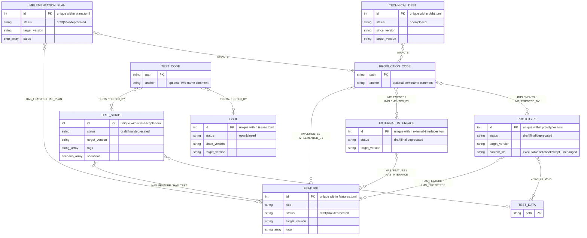
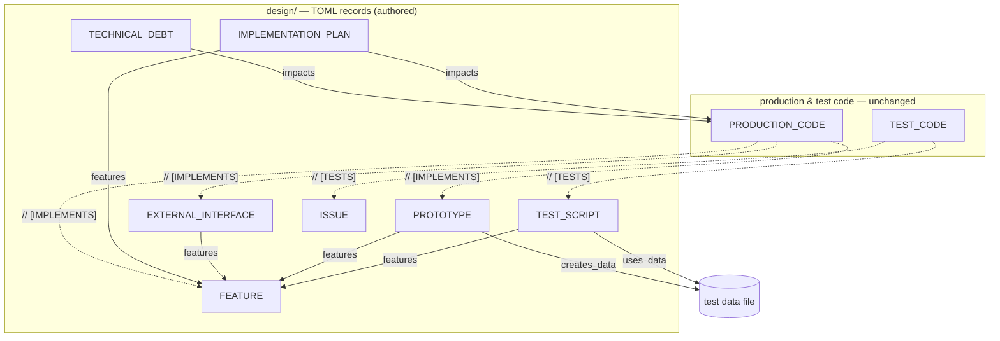

# emrg data model

`emrg` is the proposed name for a structural registry that replaces the hand-authored
markdown scaffolding in `design/` (YAML front matter + markdown link comments) with
TOML records plus a small set of harness tools (e.g. `raise_issue`, `log_debt`,
`define_feature`) that mutate them directly. The goal, per the brief: offload
*structure and linking* onto code, and leave the agent free to write *content*
without hand-maintaining link syntax, IDs, or bidirectional consistency.

This document extracts the data model implied by the current guidance
([design-documentation.md](../../references/design-documentation.md),
[design-check.R](../../scripts/design-check.R),
[developer-comments-and-logging.md](../../references/developer-comments-and-logging.md))
and the worked example under [`examples/design`](../../examples/design), and proposes
how it maps onto TOML.

---

## 1. Evidence for why this is worth doing

The current scheme already shows its fragility in the bundled example:

- `test-001-script-for-mvp.md` contains a typo, `[HAS_PROTOYPE]` instead of
  `[HAS_PROTOTYPE]`. Because `design-check.R` only requires link alt-text to match
  `^[A-Z_]+$` and never validates it against the known `EM_DESIGN_LINKS` enum, this
  typo is silently accepted as a valid-looking but meaningless link — no defect is
  raised.
- Every bidirectional relationship (e.g. `HAS_FEATURE` / `HAS_TEST`,
  `IMPLEMENTS` / `IMPLEMENTED_BY`) is hand-authored **on both ends**. `GreeterTest.java`
  carries `// [TESTS](/design/test-scripts/test-001-...)` *and*
  `test-001-script-for-mvp.md` separately carries `[TESTED_BY](/src/test/java/GreeterTest.java#...)`.
  These can and do drift; the checker only catches it as an advisory-style
  `[Defect] Missing reverse links`, after the fact.
- The relationship graph documented in `design-documentation.md` itself has a
  copy/paste bug: the "Implementation plan has 1..many feature with type HAS_FEATURE"
  comment is followed by a duplicated `ext_interface -> feature` edge instead of
  `impl_plan -> feature`. The real example (`plan-001` linking `HAS_FEATURE` to
  `feat-003`) shows what was actually intended; §4 below corrects it.

None of these are things an agent should have to get right by typing careful
markdown — they're exactly what a small typed schema and a handful of tools remove.

---

## 2. Entity model



Cardinalities are illustrative — they mirror the intent of the dot graph in
`design-documentation.md` (corrected as noted in §1) rather than a verified spec;
refine during implementation.

`SCOPE.md` and the `architecture/` docs (`FRAMEWORK.md`, `STANDARDS.md`,
decision-records) are deliberately **not** entities here — see §7 (SCOPE becomes
a generated view) and §8.7 (architecture docs left out of scope).

---

## 3. Authored vs. derived edges

The single biggest structural change: every relationship above is really *one*
fact with two names (a forward and a backward alt-text). Today both names are
hand-typed in two different files. In the new model each fact is **authored once**,
on whichever side naturally creates it, and the reverse is always a **derived**
view computed by tooling — it is never separately stored, so it can never go stale
or go missing.



Solid arrows are new TOML fields, written by a tool call. Dashed arrows are
existing code comments — those stay exactly as they are today, since code isn't
becoming TOML. Everything *not* drawn here (`HAS_TEST`, `HAS_PROTOTYPE`,
`HAS_INTERFACE`, `HAS_PLAN`, `IMPLEMENTED_BY`, `TESTED_BY`) is derived by inverting
these edges — it can be materialised into the owning TOML file as a clearly
marked, tool-maintained block (see examples below), purely for human/agent
readability, but it is never the source of truth.

---

## 4. File layout: one TOML file per type, array-of-tables per record

Rather than one file per artifact instance (`feat-001.toml`, `feat-002.toml`, ...),
each **type** gets a single TOML file holding an array of tables — `[[feature]]`,
`[[issue]]`, etc. `id` is then just an integer, unique within its own type's
file (the array/file already tells you the type, so no `feat-`/`issue-` prefix
is needed on the id itself):

```
design/
  features.toml            # [[feature]]  ...  [[feature]]
  test-scripts.toml         # [[test_script]] with nested [[test_script.scenarios]]
  prototypes.toml           # [[prototype]] — metadata only
  prototypes/               # the actual executable notebooks the records point at
    prototype-1.Rmd
  external-interfaces.toml  # [[external_interface]]
  implementation/
    plans.toml              # [[plan]]
    issues.toml              # [[issue]]
    debt.toml                 # [[technical_debt]]
```

A creation tool (`raise_issue`, `define_feature`, ...) always does the same
mechanical thing: open the one file for that type, find the highest existing
`id`, append a new `[[type]]` block with `id + 1`. The file can grow to hundreds
of records without that append becoming harder — the tool parses the file
structurally and appends a table, it never needs to locate a unique anchor
inside a wall of unrelated text the way a line-based edit would. This also
means each type's file *is* the index (`grep 'status = "open"' issues.toml`
answers "what's still open" directly) — a further reason the separate
`.agents/em/files.tsv`-style cache becomes largely redundant for design
artifacts (see §7).

Nested one-to-many data within a record uses two different TOML shapes,
picked by size:

- **Scenarios** (`test_script`) can be long (multi-line `steps` lists), so they
  use proper nested array-of-tables (`[[test_script.scenarios]]`), which stays
  readable across many lines. TOML resolves these by *order in the file*, not
  physical adjacency — a `[[test_script.scenarios]]` block belongs to whichever
  `[[test_script]]` most recently opened, so a tool inserting one must place it
  before the next `[[test_script]]` header. This is exactly the kind of
  invariant that should be tool-enforced rather than left to freehand editing.
- **Checklist steps** (`plan`, `technical_debt`) are short one-liners, so they
  use an inline array of inline tables (`steps = [{ description = "...", done = false }, ...]`)
  — self-contained inside the parent record's own fields, nothing to get
  the ordering of wrong.

Grounded in the bundled `examples/design` project, with content now written
inline rather than in a sidecar file (see §6 for why that changed):

**`design/features.toml`** (features are pure "leaves" — nothing here is
authored by the agent except `title`/`description`/`status` etc.; every
`has_*`/`implemented_by` field is a derived backlink written by `em design`):

```toml
[[feature]]
id = 1
title = "Prints hello world"
status = "final"
target_version = "0.0.1"
tags = []
description = """
Print a hello world message.

The first feature of this project enables us to have an example to test.
"""
success_criteria = "How would you measure that this feature is working from a user perspective?"

# --- derived, maintained by `em design` — do not hand-edit ---
has_test = [1]
has_prototype = [1]
has_interface = [1]
implemented_by = ["src/main/java/Greeter.java"]

[[feature]]
id = 2
title = "Greets user by name"
status = "final"
target_version = "0.3.0"
tags = ["mvp"]
description = "Send a personalised greeting so the user knows we care."
related = [1]   # was the ad hoc DEPENDS_ON link — see §8.2

has_test = [1]
has_prototype = [1]
has_interface = [1]
implemented_by = ["src/main/java/Greeter.java"]

[[feature]]
id = 3
title = "Introduce yourself"
status = "draft"
target_version = "0.4.0"
tags = ["mvp"]

has_plan = [1]
```

**`design/test-scripts.toml`** (per-scenario granularity — the current
markdown has two independently-tested scenarios, each with its own `TESTED_BY`):

```toml
[[test_script]]
id = 1
status = "final"
target_version = "0.3.0"
tags = ["mvp"]
features = [1, 2]      # authored
prototypes = [1]        # authored, optional
interfaces = [1]        # authored, optional

[[test_script.scenarios]]
name = "Test the greeting works"
steps = [
    "Setup: application started with a name passed as a positional parameter",
    "Execution: the user's {name} is read from the parameters",
    "Expectation: prints 'Hello world' and 'How are you, {name}?'",
    "Cleanup: application finished",
]
uses_data = ["src/test/resources/test-data-001-mvp.csv"]   # authored
tested_by = ["src/test/java/GreeterTest.java#test-greeting-function"]  # derived

[[test_script.scenarios]]
name = "Test the help file works"
steps = [
    "Setup: application started with --help",
    "Expectation: help text contains specific phrases",
]
tested_by = ["src/test/java/GreeterTest.java#test-help-menu"]  # derived
```

**`design/prototypes.toml`** (the prototype's actual content stays an
executable `.Rmd`/`.qmd`/script — it can't become a TOML string, so this is the
one type that keeps an external content file):

```toml
[[prototype]]
id = 1
status = "final"
target_version = "0.3.0"
tags = ["mvp"]
content_file = "design/prototypes/prototype-1.Rmd"
features = [1, 2]                                              # authored
creates_data = ["src/test/resources/test-data-001-mvp.csv"]   # authored

# --- derived ---
has_test = [1]
implemented_by = ["src/main/java/Greeter.java"]
```

**`design/external-interfaces.toml`**:

```toml
[[external_interface]]
id = 1
status = "final"
target_version = "0.3.0"
tags = ["mvp"]
description = "Static prototype example."
features = [1, 2]   # authored

# --- derived ---
implemented_by = ["src/main/java/Greeter.java"]
has_test = [1]
```

**`design/implementation/plans.toml`** (checklist steps become a structured
inline array — a tool flips `done`, the agent never edits `- [ ]` markdown):

```toml
[[plan]]
id = 1
status = "draft"
target_version = "0.4.0"
features = [3]                              # authored
impacts = ["src/main/java/Greeter.java"]   # authored
steps = [
    { description = "Extend Greeter class execute method with a \"Hello, I'm XXX\" message", done = false },
    { description = "Other steps as required", done = false },
]
```

**`design/implementation/issues.toml`**:

```toml
[[issue]]
id = 1
status = "open"
since_version = "0.0.1"
target_version = "0.4.0"
description = """
Greeter class does not allow for non-English speakers. It should detect
platform language and respond in the correct language.
"""
steps_to_reproduce = ["Set locale to french", "Call greeter function"]
expected_behaviour = "Outputs \"bonjour le monde\""
observed_behaviour = "Outputs \"hello world\""

# --- derived ---
tested_by = ["src/test/java/InternationalGreeterTest.java"]
```

**`design/implementation/debt.toml`**:

```toml
[[technical_debt]]
id = 1
status = "open"
since_version = "0.0.1"
target_version = "0.4.0"
description = "Greeter class implementation is concrete and not extensible."
impacts = ["src/main/java/Greeter.java"]   # authored
resolution_steps = [
    { description = "Step 1 ...", done = false },
    { description = "Step 2 ...", done = false },
]
```

Two distinct status vocabularies survive from the real examples, and the
model keeps them distinct rather than unifying them: `feature` / `test_script` /
`prototype` / `external_interface` / `implementation_plan` use
`draft | final | deprecated`; `issue` / `technical_debt` use `open | closed`.

---

## 5. Code-side integration (unchanged)

Production and test code stay source code — they are not converted to TOML.
`// [IMPLEMENTS](feat-001)`-style comments, `EM:` comments, and `### anchor-name`
comments keep working exactly as today. What changes is *who types them*: a
harness tool (e.g. `implements(code_ref, feature_id)`) inserts/updates the
comment on the agent's behalf, validating the target id exists first, rather
than the agent hand-typing a markdown link inside a `//` comment and hoping it
matches the target's actual path. `em design` (or its successor) still scans
code for these comments to populate the `derived` blocks shown above — that
half of `design-check.R`'s job is unchanged.

---

## 6. Where prose content lives

Revised from an earlier draft of this document, which assumed a sidecar
`.md` file per artifact was needed to keep files editable. With one file per
*type* instead of per *instance*, that concern doesn't apply the same way:
a tool never needs to locate a unique anchor inside a large file to make a
change — it parses the file, finds the record by `id`, and rewrites just that
table (or appends a new one at the end). File length stops being an editing
hazard once the mutation is structural rather than text-pattern-based.

So the default is now **inline**: `description`, `success_criteria`,
`steps_to_reproduce`, etc. are TOML string fields directly on the record
(multi-line triple-quoted strings for anything longer than a line, as shown
in §4). One exception survives: **`prototype.content_file`** stays an external
file, because a prototype's content is an *executable* notebook/script, not
prose — it genuinely cannot be a string value.

Trade-off to note: a large multi-paragraph `description` inside a TOML file
is somewhat less pleasant to read/diff in a plain text viewer than a
standalone `.md` would be (no markdown rendering, and a long triple-quoted
string reads less naturally than a normal file). If that turns out to matter
in practice, an `external-interfaces` record with a large embedded spec
(e.g. a full OpenAPI document) is the most likely candidate to want its own
`spec_file` field instead — worth revisiting once real usage shows which
records get long.

---

## 7. What this eliminates

Mapping directly onto `design-check.R`'s existing checks:

| Current check | Why it becomes structurally impossible |
|---|---|
| `[Defect] Broken links` | `ArtifactRef` fields are validated against real ids/paths at tool-call time; a tool can't create a dangling reference. |
| `[Defect] Links with incorrect target/source type` | Each field is typed (`features` only accepts feature ids, `impacts` only accepts code paths) — not a free-text alt-text string an agent could mistype. |
| `[Defect] Missing reverse links` | The reverse never exists as a separately-authored fact — it's always derived, so it can't drift out of sync. |
| `[Defect] Design artifacts without correct metadata` | `status`/`target_version` are required fields on record creation; the record can't exist without them. |
| `[Defect] Features not in SCOPE` | `SCOPE.md` becomes a generated roadmap view (features grouped by `target_version`, excluding `deprecated`) rather than a hand-maintained document — nothing to keep in sync. |
| Silent typos (e.g. `HAS_PROTOYPE`) | Link kind is a fixed tool parameter / enum, not a string typed inside markdown alt-text. |
| Need for a separate `files.tsv`-style index | Each per-type file (§4) already lists every record's `id`/`status`/`target_version` at a glance — the file *is* the index for that type. |
| `[Advisory] Implementation files with comments < 10% or > 25%` | Unaffected — this measures code, not design docs; still needed. |

---

## 8. Open questions

Not decided by this document — needs the developer's input before implementation:

1. ~~Content location~~ — resolved in §6: inline by default, external file
   only for `prototype.content_file`.
2. **Closed vs. open link-type enum**: the current example has an ad hoc
   `DEPENDS_ON` link with no defined semantics. Recommend a closed core set
   (the 12 in `EM_DESIGN_LINKS`) plus an explicit `related = [...]` free-association
   field for anything else, rather than agents inventing new upper-snake names.
3. **ID assignment**: an integer counter scoped to each type's file (§4) — the
   tool reads the file, takes `max(id) + 1`, appends. Needs to be race-safe:
   two agents creating an issue at the same moment must not both compute the
   same next id. A file lock (or an atomic "read-modify-write" via a proper
   TOML editing library) around the append is required; this is a sharper
   requirement than the one-file-per-instance version of this design, which
   only had to worry about two *different* files never colliding.
4. **Persistence of derived fields**: shown above merged back into the owning
   record (git-diffable, matches today's `.agents/em/*` convention) vs. kept
   purely as a query-time graph with no persistence at all. Recommend the
   former for continuity, but it means the tool must own a "protected block"
   convention so agents don't hand-edit derived fields.
5. **Migration**: converting the existing hand-written corpus (`examples/design/*`
   and any real project's `design/`) needs a one-off script; not designed here.
6. **Tool surface**: whether `raise_issue`/`log_debt`/`define_feature`-style
   mutations live as agent-harness tools (as the brief describes), `em`
   subcommands, or both calling shared logic — affects where validation runs
   (write-time vs. `em design` batch check) but not the data model itself.
   Whichever it is, it should use a **format-preserving** TOML library
   (e.g. `toml_edit`/`tomlkit`, not a naive parse-and-dump), otherwise the
   "do not hand-edit" comments and any human formatting choices get silently
   destroyed the first time a tool appends a record to a file a human has
   touched — which would quietly undermine the "still human editable" goal
   that motivated this whole per-type-file layout.
7. **Architecture docs out of scope**: `FRAMEWORK.md`, `STANDARDS.md`, and
   `architecture/decision-records/*` are left as narrative markdown — they don't
   have the link-churn problem this model addresses, and no case is made here
   for converting them.
