Continuous evolutionary design projects have a strong emphasis on design documentation and prototyping as a way to document and analyse the structure of a large project.

## Project structure

Set up the following folder structure in the root of the project:

1. `design`
    * `SCOPE.md`: implemented and planned features
    * `features`:  as-is and to-be features
    * `external-interfaces`: user interface, api and database structures
    * `test-scripts` - test scripts
    * `prototypes` - prototypes
    * `implementation/plans` - detailed plans for implementation of new features
    * `implementation/issues` - issue summaries
    * `implementation/debt` - technical debt records
2. `architecture`
    * `FRAMEWORK.md` - overarching technical framework description.
    * `decision-records` - architectural decision records
    * `STANDARDS.md` - code standards
3. Production code (language specific layout)
    * Source code
    * Unit tests
    * Test data
    * Integration tests
    * Continuous integration workflows
4. `skills` - (see `create-new-skill` meta skill)
    * `installing-<project>` - installation instructions
    * `getting-started-with-<project>` - instructions on downstream use of the project
    * `extending-<project>` - instructions on extending the project
    * Other skill directories will be created as needed.
5. Documentation (language specific layout - usually `docs`)
    * User documentation
    * `README.md`
    * `CONTRIBUTING.md`
6. `.agents/em` working directory:
       * `.agents/em` - Location for output of code quality and design quality checks.

An example continuous evolutionary design project available in the [examples directory](../examples/README.md). This demonstrates the structure of design documentation in the context of a simple java project.

## Design document format

The design documents are markdown with a yaml header. The header must contain `target-version` and `status` fields. A comma separated `tags` field is also recommended. Prototypes may be executable notebooks (e.g. R markdown, quarto) or executable scripts.

## Design links metamodel

Within the design folder and within comments in production and test source code, it is part of your job to maintain links between different design artifacts and links between design artifacts and code.

The links are markdown style links (relative or absolute from the root of the project) with the relationship type in the alt texts, e.g. `[HAS_FEATURE](/design/feature/feat-001.md)`. In markdown these links will be normal markdown links, in executable code then a code comment containing the markdown link will be recognised (e.g. `// [IMPLEMENTS](/design/features/my-example-feature.md)`).

The line number of the source of link is reported in `.agents/em/links.tsv` by the [design-check.R](../scripts/design-check.R) script. Link targets are also extracted but not currrently checked by the script.

In source code anchors are defined by a comment containing an 3rd level markdown header, and are matched to the first word using exact match, so an link such as this: `[IMPLEMENTED_BY](/src/main/java/MyClass.java#myMethod)`, will link to a single line comment `  // ### myMethod` in the class.

The following relationship types have particular meaning, but any link with alt text in upper snake case is extracted into `.agents/em/links.tsv`:

**Links within design folder:**

- "HAS_FEATURE"
  - source: any design document (usually a feature)
  - target: A feature: `/design/features/AAA.md`
- "HAS_TEST"
  - source: any design document (usually a feature)
  - target: A test-script: `/design/test-scripts/BBB.md`
- "HAS_PROTOTYPE"
  - source: any design document (usually a feature)
  - target: A prototype: `/design/prototypes/CCC.md`
- "HAS_INTERFACE"
  - source: any design document (usually a feature)
  - target: An external interface: `/design/external-interfaces/DDD.md`
- "HAS_PLAN"
  - source: any design document (usually a feature)
  - target: An implementation plan: `/design/implementation/plan/GGG.md`

Links within the design folder must be bi-directional.

`test-scripts`, `prototypes`, `external-interfaces`, and `implementation/plans` must link to `features`. If they exist then `features` must back-reference these.

**Links between design folder and production code:**

- "IMPLEMENTS"/"IMPLEMENTED_BY" which design artifacts does production code implement and vice versa:
  - forward: production code
  - backward: A design feature `/design/features/AAA.md`, prototype `/design/prototypes/CCC.md` or external interfaces `/design/external-interfaces/DDD.md`

**Links between design folder and test code:**

- "TESTS"/"TESTED_BY" which test-script or issue does test code implement or reproduce and vice versa:
  - forward: test code
  - backward: A test-script `/design/test-scripts/BBB.md` or implementation issue: `/design/implementation/issues/EEE.md`

**Links between design folder and test data:**

Test data can't generally contain links so the following linkages are unidirectional:

- "USES_DATA" which test data is used by a test-script
  - source: a test script (uses)
  - target: A test data file (langague specific location)
- "CREATES_DATA" which test data is produced by a prototype
  - source: prototype (produces)
  - target: A test data file (langague specific location)

**Links between implementation plans and technical debt and production code (unidirectional):**

- "IMPACTS" which technical debt / implementation plans affects production code
  - source: a technical debt record `/design/implementation/debt/FFF.md` or an implementation plan `/design/implementation/plan/GGG.md`
  - target: production code

## Link validity

The validity of links and its source and target are checked by the [design-check.R](../scripts/design-check.R) script using this set of relationships:

```dot
digraph DocumentRelationships {
    // Graph styling
    rankdir=TB;
    edge [dir=forward];

    // Nodes (Document Types)
    prototype [label="Prototype"];
    test_script [label="Test script"];
    feature [label="Feature"];
    ext_interface [label="External interface"];
    issue [label="Issue"];
    test_data [label="Test data"];
    prod_code [label="Production code"];
    test_code [label="Test code"];
    tech_debt [label="Technical debt"];
    impl_plan [label="Implementation plan"];

    // Edges (Typed hyperlinks)

    // Design documentation <-> Design documentation

    // Feature <-> Test Script

    // Test Script links to 1..many Feature with type "HAS_FEATURE"
    test_script -> feature [arrowtail=none, arrowhead=crow, headlabel="HAS_FEATURE"];

    // Feature links to 1..many Test Script with type "HAS_TEST"
    feature -> test_script [arrowtail=none, arrowhead=crow, headlabel="HAS_TEST"];

    // Feature <-> Prototype

    // Prototype has 1..many Feature with type "HAS_FEATURE"
    prototype -> feature [arrowtail=none, arrowhead=crow, headlabel="HAS_FEATURE"];

    // Feature has 0..many Prototype with type "HAS_PROTOTYPE"
    feature -> prototype [arrowtail=odot, arrowhead=crow, headlabel="HAS_PROTOTYPE"];

    // Feature <-> External interfaces

    // Feature has 0..many External interfaces with type "HAS_INTERFACE"
    feature -> ext_interface [arrowtail=none, arrowhead=crow, headlabel="HAS_INTERFACE"];

    // External interfaces has 0..many feature with type "HAS_FEATURE"
    ext_interface -> feature [arrowtail=none, arrowhead=crow, headlabel="HAS_FEATURE"];

    // Feature <-> Implementation plan

    // Feature has 0..many Implementation plans with type "HAS_PLAN"
    feature -> impl_plan [arrowtail=none, arrowhead=crow, headlabel="HAS_PLAN"];

    // Implementation plan has 1..many feature with type "HAS_FEATURE"
    ext_interface -> feature [arrowtail=none, arrowhead=crow, headlabel="HAS_FEATURE"];

    // Design documentation -> Test data

    // Test script uses 0..1 Test data with type "USES_DATA"
    test_script -> test_data [arrowtail=odot, arrowhead=none, headlabel="USES_DATA"];

    // Prototype creates 1..many Test data with type "CREATES_DATA"
    prototype -> test_data [arrowtail=none, arrowhead=crow, headlabel="CREATES_DATA"];

    // Production and test code <-> Design documentation

    // Production code implements 1..many Features
    prod_code -> feature [arrowtail=none, arrowhead=crow, headlabel="IMPLEMENTS"];

    // Feature implemented by 1..many Production code
    feature -> prod_code [arrowtail=none, arrowhead=crow, headlabel="IMPLEMENTED_BY"];

    // Production code implements 0..many External interfaces
    prod_code -> ext_interface [arrowtail=odot, arrowhead=crow, headlabel="IMPLEMENTS"];

    // External interface implemented by 0..many Production code
    ext_interface -> prod_code [arrowtail=odot, arrowhead=crow, headlabel="IMPLEMENTED_BY"];

    // Production code implements 0..many Prototypes
    prod_code -> prototype [arrowtail=odot, arrowhead=crow, headlabel="IMPLEMENTS"];

    // Prototype implemented by 0..many Production code
    prototype -> prod_code [arrowtail=odot, arrowhead=crow, headlabel="IMPLEMENTED_BY"];

    // Test code <-> Design documentation

    // Test code implements 0..many Test scripts
    test_code -> test_script [arrowtail=odot, arrowhead=crow, headlabel="TESTS"];

    // Test scripts implemented by 1..many Test code
    test_script -> test_code [arrowtail=none, arrowhead=crow, headlabel="TESTED_BY"];

    // Test code reproduces 0..one issue.
    test_code -> issue [arrowtail=odot, arrowhead=none,headlabel="TESTS"];

    // Issue reproduced by 1..many Test code
    issue -> test_code [arrowtail=none, arrowhead=crow, headlabel="TESTED_BY"];

    // Technical debt -> production code

    // Technical debt record impacts 1..many Production code.
    tech_debt -> prod_code [arrowtail=none, arrowhead=crow, headlabel="IMPACTS"];

    // Implementation plan -> production code

    // Technical debt record impacts 1..many Production code.
    impl_plan -> prod_code [arrowtail=none, arrowhead=crow, headlabel="IMPACTS"];

}
```

